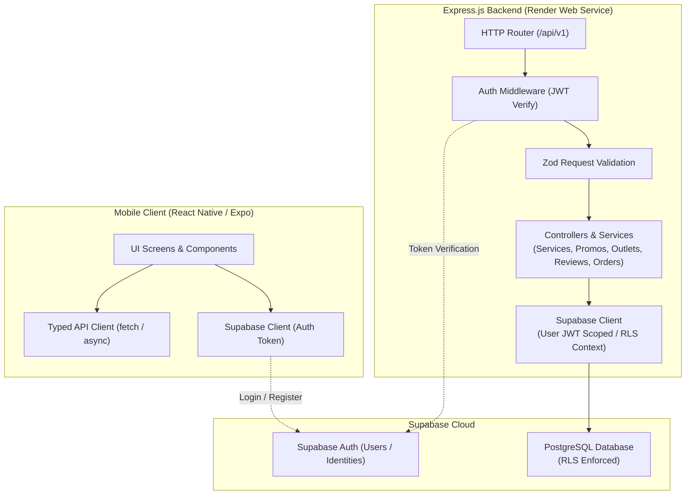

# PJLaundry Backend Architecture & Implementation Documentation

Dokumentasi arsitektur, spesifikasi teknis, skema database, kontrak API, serta panduan deployment untuk sistem backend **PJLaundry**.

---

## 1. Arsitektur Sistem



### 1.1 Lokasi Backend & Konfigurasi Workspace
- **Backend Service:** Berada di root `/Users/surya/Desktop/PJLaundry_Backend`.
- **Render Web Service Root Directory:** `./` (Root direktori repository).
- **Mobile Client:** Berada di `/Users/surya/Desktop/project_mobile`, terkoneksi via environment variable `EXPO_PUBLIC_API_URL`.

---

## 2. Struktur Folder Backend

```text
PJLaundry_Backend/
├── docs/
│   ├── PJLaundry_Backend_Agent_Spec.md
│   └── BACKEND_IMPLEMENTATION.md
├── src/
│   ├── config/
│   │   ├── env.ts                  # Validasi env Zod (type-safe)
│   │   └── supabase.ts             # Client Supabase (Anon + Auth Scoped)
│   ├── middleware/
│   │   ├── auth.middleware.ts      # Verifikasi JWT Supabase Auth
│   │   ├── error.middleware.ts     # Centralized error handler
│   │   ├── not-found.middleware.ts # Handler 404
│   │   └── validate.middleware.ts  # Validator skema Zod (body, query, params)
│   ├── modules/
│   │   ├── health/
│   │   │   ├── health.controller.ts
│   │   │   └── health.routes.ts
│   │   ├── services/
│   │   │   ├── service.controller.ts
│   │   │   ├── service.routes.ts
│   │   │   ├── service.service.ts
│   │   │   └── service.schema.ts
│   │   ├── promos/
│   │   │   ├── promo.controller.ts
│   │   │   ├── promo.routes.ts
│   │   │   ├── promo.service.ts
│   │   │   └── promo.schema.ts
│   │   ├── outlets/
│   │   │   ├── outlet.controller.ts
│   │   │   ├── outlet.routes.ts
│   │   │   ├── outlet.service.ts
│   │   │   └── outlet.schema.ts
│   │   ├── reviews/
│   │   │   ├── review.controller.ts
│   │   │   ├── review.routes.ts
│   │   │   ├── review.service.ts
│   │   │   └── review.schema.ts
│   │   └── orders/
│   │       ├── order.controller.ts
│   │       ├── order.routes.ts
│   │       ├── order.service.ts
│   │       └── order.schema.ts
│   ├── types/
│   │   ├── api.types.ts            # Standar response, pagination, error
│   │   └── database.types.ts       # Database interface types
│   ├── utils/
│   │   └── response.ts             # Helper response builder
│   ├── app.ts                      # Konfigurasi Express, CORS, Helmet, Logger
│   └── server.ts                   # Entry point server (0.0.0.0:PORT)
├── supabase/
│   └── migrations/
│       ├── 20261109000000_init_pjlaundry_schema.sql
│       ├── 20261109000001_seed_initial_data.sql
│       └── 20261110000000_atomic_order_creation.sql
├── tests/
│   ├── health.test.ts
│   └── services.test.ts
├── .env.example
├── .gitignore
├── package.json
├── tsconfig.json
└── README.md
```

---

## 3. Skema Database Supabase PostgreSQL & RLS

Skema dirancang memenuhi seluruh atribut yang dibutuhkan oleh mobile app (seperti kategori, min/max order, durasi, icon lucide, tagline, array fitur), sekaligus mendukung integritas relasional 3NF.

### 3.1 Tabel `services` (Katalog Layanan Laundry)
```sql
CREATE TABLE IF NOT EXISTS public.services (
    id VARCHAR(50) PRIMARY KEY, -- e.g. 'kiloan-komplit', 'kiloan-express'
    name VARCHAR(100) NOT NULL,
    category VARCHAR(30) NOT NULL CHECK (category IN ('kiloan', 'satuan', 'special')),
    price DECIMAL(12,2) NOT NULL CHECK (price >= 0),
    unit VARCHAR(20) NOT NULL, -- 'kg', 'pcs', 'pasang'
    min_order INT NOT NULL DEFAULT 1 CHECK (min_order > 0),
    max_order INT NOT NULL DEFAULT 50 CHECK (max_order >= min_order),
    duration VARCHAR(50) NOT NULL, -- e.g. '2 Hari', '24 Jam'
    icon VARCHAR(50) NOT NULL DEFAULT 'WashingMachine',
    is_express BOOLEAN NOT NULL DEFAULT FALSE,
    tagline TEXT NOT NULL,
    features TEXT[] NOT NULL DEFAULT '{}',
    is_active BOOLEAN NOT NULL DEFAULT TRUE,
    created_at TIMESTAMPTZ NOT NULL DEFAULT NOW(),
    updated_at TIMESTAMPTZ NOT NULL DEFAULT NOW()
);
```

### 3.2 Tabel `promos` (Promosi & Diskon)
```sql
CREATE TABLE IF NOT EXISTS public.promos (
    id UUID PRIMARY KEY DEFAULT gen_random_uuid(),
    code VARCHAR(30) UNIQUE NOT NULL,
    title VARCHAR(100) NOT NULL,
    description TEXT NOT NULL,
    discount_type VARCHAR(20) NOT NULL CHECK (discount_type IN ('percentage', 'fixed')),
    discount_value DECIMAL(12,2) NOT NULL CHECK (discount_value > 0),
    min_order_amount DECIMAL(12,2) NOT NULL DEFAULT 0,
    max_discount DECIMAL(12,2) NULL,
    start_date TIMESTAMPTZ NOT NULL,
    end_date TIMESTAMPTZ NOT NULL,
    is_active BOOLEAN NOT NULL DEFAULT TRUE,
    created_at TIMESTAMPTZ NOT NULL DEFAULT NOW(),
    updated_at TIMESTAMPTZ NOT NULL DEFAULT NOW()
);
```

### 3.3 Tabel `outlets` (Cabang Laundry)
```sql
CREATE TABLE IF NOT EXISTS public.outlets (
    id UUID PRIMARY KEY DEFAULT gen_random_uuid(),
    name VARCHAR(100) NOT NULL,
    address TEXT NOT NULL,
    phone VARCHAR(20) NOT NULL,
    opening_hours VARCHAR(50) NOT NULL DEFAULT '07:00 - 21:00',
    latitude DECIMAL(10,8) NULL,
    longitude DECIMAL(11,8) NULL,
    is_active BOOLEAN NOT NULL DEFAULT TRUE,
    created_at TIMESTAMPTZ NOT NULL DEFAULT NOW(),
    updated_at TIMESTAMPTZ NOT NULL DEFAULT NOW()
);
```

### 3.4 Tabel `orders` (Header Pesanan)
```sql
CREATE TABLE IF NOT EXISTS public.orders (
    id UUID PRIMARY KEY DEFAULT gen_random_uuid(),
    order_number VARCHAR(50) UNIQUE NOT NULL,
    user_id UUID NOT NULL REFERENCES auth.users(id) ON DELETE CASCADE,
    outlet_id UUID NULL REFERENCES public.outlets(id) ON DELETE SET NULL,
    status VARCHAR(30) NOT NULL DEFAULT 'pending' 
        CHECK (status IN ('pending', 'confirmed', 'pickup_scheduled', 'processing', 'completed', 'cancelled')),
    total_price DECIMAL(12,2) NOT NULL CHECK (total_price >= 0),
    pickup_address TEXT NOT NULL,
    pickup_date VARCHAR(50) NOT NULL,
    pickup_slot VARCHAR(50) NOT NULL,
    order_notes TEXT NULL,
    created_at TIMESTAMPTZ NOT NULL DEFAULT NOW(),
    updated_at TIMESTAMPTZ NOT NULL DEFAULT NOW()
);
```

### 3.5 Tabel `order_items` (Rincian Item Pesanan)
```sql
CREATE TABLE IF NOT EXISTS public.order_items (
    id UUID PRIMARY KEY DEFAULT gen_random_uuid(),
    order_id UUID NOT NULL REFERENCES public.orders(id) ON DELETE CASCADE,
    service_id VARCHAR(50) NOT NULL REFERENCES public.services(id) ON DELETE RESTRICT,
    quantity DECIMAL(10,2) NOT NULL CHECK (quantity > 0),
    unit_price DECIMAL(12,2) NOT NULL CHECK (unit_price >= 0), -- Snapshot harga saat pemesanan
    subtotal DECIMAL(12,2) NOT NULL CHECK (subtotal >= 0),
    notes TEXT NULL,
    created_at TIMESTAMPTZ NOT NULL DEFAULT NOW()
);
```

### 3.6 Tabel `reviews` (Ulasan Pelanggan)
```sql
CREATE TABLE IF NOT EXISTS public.reviews (
    id UUID PRIMARY KEY DEFAULT gen_random_uuid(),
    user_id UUID NOT NULL REFERENCES auth.users(id) ON DELETE CASCADE,
    order_id UUID NULL REFERENCES public.orders(id) ON DELETE SET NULL,
    rating INT NOT NULL CHECK (rating >= 1 AND rating <= 5),
    comment TEXT NOT NULL,
    user_display_name VARCHAR(100) NULL,
    is_published BOOLEAN NOT NULL DEFAULT TRUE,
    created_at TIMESTAMPTZ NOT NULL DEFAULT NOW(),
    updated_at TIMESTAMPTZ NOT NULL DEFAULT NOW()
);
```

### 3.7 Kebijakan Keamanan Row Level Security (RLS)
```sql
-- Aktifkan RLS di setiap tabel
ALTER TABLE public.services ENABLE ROW LEVEL SECURITY;
ALTER TABLE public.promos ENABLE ROW LEVEL SECURITY;
ALTER TABLE public.outlets ENABLE ROW LEVEL SECURITY;
ALTER TABLE public.orders ENABLE ROW LEVEL SECURITY;
ALTER TABLE public.order_items ENABLE ROW LEVEL SECURITY;
ALTER TABLE public.reviews ENABLE ROW LEVEL SECURITY;

-- 1. Publik Read-Only (Services, Promos, Outlets)
CREATE POLICY "Public read active services" ON public.services 
    FOR SELECT USING (is_active = true);

CREATE POLICY "Public read active promos" ON public.promos 
    FOR SELECT USING (is_active = true AND NOW() BETWEEN start_date AND end_date);

CREATE POLICY "Public read active outlets" ON public.outlets 
    FOR SELECT USING (is_active = true);

-- 2. User-Scoped Private Access (Orders)
CREATE POLICY "Users can select own orders" ON public.orders 
    FOR SELECT TO authenticated USING (auth.uid() = user_id);

CREATE POLICY "Users can insert own orders" ON public.orders 
    FOR INSERT TO authenticated WITH CHECK (auth.uid() = user_id);

-- 3. User-Scoped Items (Order Items)
CREATE POLICY "Users can select own order items" ON public.order_items 
    FOR SELECT TO authenticated 
    USING (EXISTS (SELECT 1 FROM public.orders WHERE public.orders.id = public.order_items.order_id AND public.orders.user_id = auth.uid()));

CREATE POLICY "Users can insert own order items" ON public.order_items 
    FOR INSERT TO authenticated 
    WITH CHECK (EXISTS (SELECT 1 FROM public.orders WHERE public.orders.id = public.order_items.order_id AND public.orders.user_id = auth.uid()));

-- 4. Reviews
CREATE POLICY "Public read published reviews" ON public.reviews 
    FOR SELECT USING (is_published = true);

CREATE POLICY "Users can insert own review" ON public.reviews 
    FOR INSERT TO authenticated WITH CHECK (auth.uid() = user_id);
```

---

## 4. Kontrak REST API v1

Format respon baku untuk kesuksesan:
```json
{
  "success": true,
  "message": "Deskripsi singkat hasil",
  "data": {},
  "meta": {
    "total": 1,
    "page": 1,
    "limit": 10
  }
}
```

Format respon baku untuk kegagalan:
```json
{
  "success": false,
  "message": "Deskripsi pesan error untuk user",
  "data": null,
  "errors": []
}
```

### Tabel Rute API:
| Method | Endpoint | Akses | Parameter / Body | Deskripsi |
|---|---|---|---|---|
| `GET` | `/api/v1/health` | Public | - | Status kesehatan service & koneksi database |
| `GET` | `/api/v1/services` | Public | `category`, `search`, `limit`, `page` | Daftar katalog layanan laundry |
| `GET` | `/api/v1/services/:id` | Public | `id` (slug string) | Rincian lengkap 1 layanan |
| `GET` | `/api/v1/promos` | Public | `active_only` | Daftar promo aktif |
| `GET` | `/api/v1/outlets` | Public | `search` | Daftar cabang outlet laundry |
| `GET` | `/api/v1/reviews` | Public | `limit`, `page` | Daftar ulasan pelanggan |
| `POST` | `/api/v1/orders` | Auth | `items`, `pickup_address`, `pickup_date`, `pickup_slot`, `order_notes` | Buat order baru melalui RPC transaksi atomik |
| `GET` | `/api/v1/orders/me` | Auth | `status`, `page`, `limit` | Riwayat order milik user login |
| `GET` | `/api/v1/orders/:id` | Auth | `id` (UUID) | Rincian status order milik user |

---

## 5. Alur Autentikasi & Autorisasi

1. **Client Identity:** Aplikasi mobile menggunakan Supabase Client untuk login (via Email/Password atau OTP).
2. **Token Passing:** Setiap HTTP request yang membutuhkan proteksi menyertakan header:
   ```http
   Authorization: Bearer <Supabase_Access_Token>
   ```
3. **Server Validation:** Express Auth Middleware mengambil Bearer token dan memverifikasi integritasnya melalui `supabase.auth.getUser(token)`.
4. **Context Injection:** Data user terverifikasi diinjeksikan ke objek `req.user = { id: user.id, email: user.email }`.
5. **Scoped Database Access:** Untuk query data privat, backend membuat instance Supabase client yang membawa header JWT user tersebut:
   ```typescript
   createScopedSupabaseClient(req.token)
   ```
   Sehingga Postgres RLS mengevaluasi `auth.uid() = user_id` secara langsung.
6. **Data Ownership:** Backend tidak pernah mempercayai `user_id` dari body request, melainkan selalu menyematkan `user_id = req.user.id`.

Pembuatan order menggunakan fungsi PostgreSQL
`public.create_order_with_items` pada migration
`20261110000000_atomic_order_creation.sql`. Fungsi mengambil user dari
`auth.uid()` dan menyimpan header beserta seluruh item dalam satu transaksi,
sehingga kegagalan penyimpanan item tidak meninggalkan order parsial.

---

## 6. Referensi Environment Variables

### Backend (`.env`)
```env
PORT=3000
NODE_ENV=development
SUPABASE_URL=https://your-supabase-project.supabase.co
SUPABASE_ANON_KEY=your-supabase-anon-or-publishable-key
SUPABASE_SERVICE_ROLE_KEY=your-supabase-service-role-key-optional
CORS_ORIGINS=*
```

### Mobile Client (`project_mobile/.env`)
```env
EXPO_PUBLIC_API_URL=http://localhost:3000/api/v1
EXPO_PUBLIC_SUPABASE_URL=https://your-supabase-project.supabase.co
EXPO_PUBLIC_SUPABASE_ANON_KEY=your-supabase-anon-or-publishable-key
```
*(Catatan: Untuk pengujian Expo Go di smartphone fisik, ganti `localhost` dengan IP LAN komputer, misal `http://192.168.1.10:3000/api/v1`)*.
